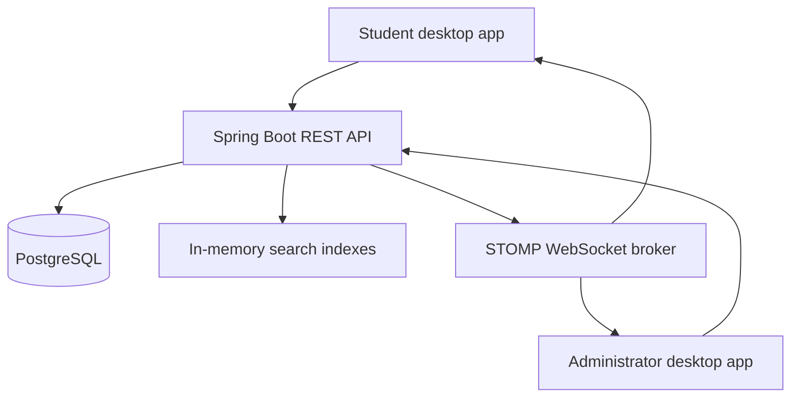

# IntelliLib
### Intelligent Digital Library Search & Management System

**IntelliLib** is a Java-based desktop library application for searching a real library catalogue, requesting and issuing physical books, managing students and inventory, and tracking returns. It has two application roles—**Student** and **Administrator**—and connects the JavaFX desktop client to a shared Spring Boot API and PostgreSQL database.

> **Project context:** KLH CSE | DSA-3 | Section S8 | Team 2 | Academic year 2026–27  
> **Repository status:** Source code and setup instructions are provided. A full end-to-end build, cloud deployment, and physical webcam test have **not** been independently verified as part of this README update. See [Validation & known limitations](#validation--known-limitations).

## Contents
- [What the application does](#what-the-application-does)
- [Technology stack](#technology-stack)
- [Architecture](#architecture)
- [Project layout](#project-layout)
- [Run locally on Windows](#run-locally-on-windows)
- [First-time data setup](#first-time-data-setup)
- [Typical library workflow](#typical-library-workflow)
- [Algorithms and data structures](#algorithms-and-data-structures)
- [Build the Windows application](#build-the-windows-application)
- [Cloud deployment](#cloud-deployment)
- [Testing](#testing)
- [Security notes](#security-notes)
- [Validation & known limitations](#validation--known-limitations)
- [Project documentation](#project-documentation)
- [Team](#team)

## What the application does

| Student | Administrator |
| --- | --- |
| Sign in by scanning an enrolled college ID QR/barcode using the in-app webcam | Sign in with administrator email and password |
| Search by book title, author, ISBN, category and indexed keywords | View live catalogue, student, request and loan counts |
| See search suggestions, related books and available-copy counts | Add books and register physical copies |
| Explore borrowing-based popular books and activity-based recommendations | Import student, book and copy records from CSV; export books |
| Submit book requests and track approval status | Approve/reject requests and provide approved books |
| View borrowed books, due dates and notifications | Verify a student ID, process returns, and inspect loan/audit history |

**Important workflow detail:** In the current desktop UI, an administrator may provide an approved book after scanning the student's ID and confirming the approved request. The backend selects a registered available copy when no specific copy barcode is supplied. The return screen similarly scans the student ID and lets the administrator choose an active loan to return. Separate barcode-based backend endpoints also exist. **The inventory must still contain registered physical-copy records; no copy can be issued without available inventory.**

Production records are not fabricated or populated from a demonstration catalogue. The administrator must import or register the real books, students and copies. Popularity and recommendations depend on actual stored activity.

## Technology stack

| Layer | Technology |
| --- | --- |
| Desktop client | Java 21, JavaFX 21, JavaFX CSS |
| Desktop camera scanning | Webcam Capture + ZXing |
| API and business logic | Java 21, Spring Boot 3.5.6 |
| Communication | REST over HTTP(S), STOMP over WebSocket |
| Database | PostgreSQL (local Docker Compose uses PostgreSQL 17) |
| Schema migrations | Flyway |
| Data access | Spring JDBC / JdbcTemplate |
| Authentication support | BCrypt, SHA-256 session-token hashing, HMAC-SHA256 for student card codes |
| Builds and packaging | Maven, PowerShell/Batch, `jpackage` |
| Optional cloud hosting | Render for the API, Neon for PostgreSQL |

This is a **desktop application**, not a browser-based library website.

## Architecture



- **Client:** JavaFX screens, local webcam decoding, API calls and real-time notification subscription.
- **Server:** Authentication, catalogue/search, student administration, request approval, circulation and activity logging.
- **Database:** Users, sessions, books, physical copies, requests, loans, views, notifications and audit history.
- **Migrations:** Flyway creates/updates tables using the versioned SQL files.

## Project layout

The working application lives inside **`IntelliLib_Production/`**. Run the following commands from that folder unless stated otherwise.

```text
.
├── README.md                         # This repository guide
└── IntelliLib_Production/
    ├── client/                       # JavaFX desktop application
    │   ├── pom.xml
    │   └── src/main/
    ├── server/                       # Spring Boot API, services, DSA, SQL migrations, tests
    │   ├── pom.xml
    │   ├── Dockerfile
    │   └── src/
    ├── data/templates/               # CSV import templates
    ├── scripts/                      # Windows start, run and build helpers
    ├── docs/                         # Technical and user documentation
    ├── deployment/render.yaml        # Additional Render blueprint copy
    ├── docker-compose.yml            # Local PostgreSQL + API
    ├── render.yaml                   # Render blueprint, see caveat below
    ├── QUICK_START.md
    ├── VALIDATION_REPORT.md
    └── README.md                     # Original production-module guide
```

## Run locally on Windows

### Requirements
- **Windows** PC with a **JDK 21** installation for development and `jpackage`.
- **Docker Desktop**, installed and running, for the local API/PostgreSQL stack.
- Internet access for the initial Docker images and Maven dependencies.
- A usable webcam and Windows camera permission for ID/barcode scanning.
- **Maven:** Installed system-wide *or* downloaded by the included `Get-Maven.ps1` helper when launching/building the client.

### 1. Clone and enter the application folder

```bat
git clone https://github.com/NITHISHSENTHIL2025/KLH_CSE_2026-27_DSA-3_S8_TEAM2_LIBRARY_SYSTEM.git
cd KLH_CSE_2026-27_DSA-3_S8_TEAM2_LIBRARY_SYSTEM\IntelliLib_Production
```

If you downloaded the repository as a ZIP, extract it and open a terminal in `IntelliLib_Production` instead.

### 2. Start PostgreSQL and the API

```bat
scripts\START_SERVER_WINDOWS.bat
```

This runs `docker compose up -d --build`, starts the database and backend, and checks the health endpoint. To verify it manually, open:

**http://localhost:8080/api/health**

The response should contain `"ok": true` when the API and database are available.

### 3. Launch the desktop client

In another terminal, still in `IntelliLib_Production`:

```bat
scripts\RUN_CLIENT_WINDOWS.bat
```

Choose **Administrator** to perform the first-time catalogue setup. The local-only bootstrap login is configured in `docker-compose.yml`. **Do not reuse these development credentials in production.**

### 4. Stop local services

```bat
scripts\STOP_SERVER_WINDOWS.bat
```

Alternatively, run `docker compose down` inside `IntelliLib_Production`. Avoid `docker compose down -v` unless you deliberately want to delete the local database volume and its stored records.

## First-time data setup

On a fresh database, the application creates the configured administrator but does **not** insert sample students, books or copy inventory. Sign in as Administrator and import your library's records.

Use these included templates:

| Import | File | Required fields |
| --- | --- | --- |
| Students | [`students_template.csv`](IntelliLib_Production/data/templates/students_template.csv) | `student_code`, `name`, `card_code` |
| Books | [`books_template.csv`](IntelliLib_Production/data/templates/books_template.csv) | `title`, `author` |
| Physical copies | [`book_copies_template.csv`](IntelliLib_Production/data/templates/book_copies_template.csv) | `isbn`, `barcode` |

- **Student card:** `card_code` must match the actual decoded value on the enrolled college ID. The server stores its HMAC hash, not the raw code.
- **Book records:** ISBN, category, description, author, publisher, keywords and similar metadata help search and display.
- **Copies:** Each inventory copy needs a unique stored identifier (`barcode`); the copy CSV links it to an existing book by ISBN. A book can have multiple physical copies.
- **Issuing without scanning a book label:** The current approval screen can assign a registered available copy without scanning that copy at handover. This does not create inventory automatically and does not remove the need for accurate physical inventory procedures.

See [CSV formats](IntelliLib_Production/docs/CSV_FORMAT.md) and [real-data import guide](IntelliLib_Production/docs/REAL_DATA_IMPORT.md) for details.

## Typical library workflow

1. An administrator imports/enrols actual students, books and available copies.
2. A student scans the registered college ID to sign in.
3. The student searches the catalogue and requests an available book.
4. The administrator reviews and approves or rejects the request.
5. For an approved request, the administrator scans the student's ID and provides the book; the system records a loan and due date.
6. The student sees the loan and relevant notification.
7. During return, the administrator scans the student's ID, chooses the correct active loan and confirms the return.
8. The server updates the loan, request and copy availability; the audit history records circulation actions.

Request and loan operations use database transactions, with row locking in key circulation paths. The scheduled maintenance job marks expired approvals and overdue loans.

## Algorithms and data structures

The DSA implementation is located at [`server/.../dsa/`](IntelliLib_Production/server/src/main/java/com/intellilib/server/dsa). Algorithm names are implementation details, not separate features in the normal user interface.

| Implementation | Code-backed purpose |
| --- | --- |
| Custom hash table | ISBN and searchable-token indexing |
| Trie | Prefix-based title/author suggestions |
| AVL tree | Ordered title browsing and prefix-range retrieval |
| Graph and adjacency lists | Discovering related books through shared metadata |
| Knuth–Morris–Pratt (KMP) | Query-text occurrence matching within search ranking |
| Edit distance | Limited typo-tolerant title/author matching |
| Rabin–Karp | Implemented as a matcher utility and covered by a unit test, **but not currently invoked by the main `SearchEngine`** |

The [`SearchEngine.java`](IntelliLib_Production/server/src/main/java/com/intellilib/server/search/SearchEngine.java) rebuilds in-memory indexes from real PostgreSQL records, ranks results, and refreshes availability after relevant inventory changes. PostgreSQL remains the durable source of truth.

## Build the Windows application

From `IntelliLib_Production` on a Windows development machine with JDK 21:

**Portable Windows app (bundled runtime):**

```bat
scripts\BUILD_WINDOWS_PORTABLE.bat
```

Expected output:

```text
client\dist\IntelliLib\IntelliLib.exe
```

Distribute the complete `client\dist\IntelliLib\` directory, not only the EXE file. Target Windows PCs do not need a separate JDK, Maven, PostgreSQL or Docker; they still need network access to the API.

**Optional Windows EXE installer:**

```bat
scripts\BUILD_WINDOWS_INSTALLER.bat
```

The installer is placed in `client\installer\` if packaging succeeds. Some JDK installations require the WiX Toolset.

## Cloud deployment

The intended hosted architecture is **Windows IntelliLib client → Render Spring Boot API → Neon PostgreSQL**.

1. Create a Neon PostgreSQL database.
2. Create a Render Docker Web Service using this repository.
3. For a **manual Render service connected to this repository root**, set the service root directory to **`IntelliLib_Production/server`** and use the Dockerfile in that directory.
4. Configure the health check path as `/api/health` and add required secrets in Render's environment settings.
5. Deploy and verify `https://YOUR-SERVICE.onrender.com/api/health`.
6. In IntelliLib, open **Server settings** and save the HTTPS base URL, or run `scripts\SET_CLOUD_SERVER_WINDOWS.bat`. You can also use the `INTELLILIB_SERVER_URL` environment variable.
7. Sign in as administrator and import the real library dataset.

**Required/important Render variables:**

| Variable | Purpose |
| --- | --- |
| `DATABASE_URL` | Neon PostgreSQL connection URL |
| `APP_CARD_PEPPER` | Strong, private HMAC key for student card codes |
| `APP_BOOTSTRAP_ADMIN_EMAIL` | Initial administrator email |
| `APP_BOOTSTRAP_ADMIN_PASSWORD` | Strong initial administrator password |
| `APP_DEFAULT_DUE_DAYS` | Optional loan duration; default is 14 days |

**Blueprint path caveat:** The existing `IntelliLib_Production/render.yaml` and `deployment/render.yaml` specify `rootDir: server`, but this GitHub repository nests `server` inside `IntelliLib_Production`. Review/correct the blueprint path for the repository root before using it; the manual root-directory setting above is explicit.

Render Free instances may become idle and take time to wake. This is suitable for a demonstration/pilot, not a guaranteed always-on library service. See [deployment guide](IntelliLib_Production/docs/RENDER_NEON_DEPLOYMENT.md).

## Testing

From a development environment with Java 21 and Maven:

```bat
cd IntelliLib_Production\server
mvn test
mvn package
cd ..\client
mvn package
```

These commands are intended to run **from the repository root**. The included backend JUnit class `DsaCoreTest.java` tests the hash table, trie, AVL tree, KMP, Rabin–Karp and edit distance.

The GitHub Actions workflow [`intellilib-ci.yml`](.github/workflows/intellilib-ci.yml) packages the backend and client with `-DskipTests`. A successful packaging workflow therefore **does not establish passing tests or end-to-end readiness**.

For a release, additionally test: correct/unknown student IDs, camera permissions, accurate imports, search results, request approval/denial, provision of the correct approved book, prevention of duplicate issues, return handling, notifications and database persistence after restart. See the [test plan](IntelliLib_Production/docs/TEST_PLAN.md).

## Security notes

- Never commit real Render, Neon or administrator credentials.
- Use a unique, strong `APP_CARD_PEPPER` and administrator password for any public deployment. The local defaults are **development-only**.
- The server hashes student card codes with HMAC-SHA256 and stores hashed session tokens; administrator passwords use BCrypt.
- Printed QR/barcodes can be copied. Administrators should visually verify the student's identity and actual physical book during collection/return.
- **Production hardening required:** The current WebSocket configuration permits all origins and does not implement authenticated topic subscription authorization. Do not assume per-user notification topics are private until this is fixed.
- Use HTTPS/WSS for hosted connections. Restrict deployments and audit access as required by your institution.

See the [security design](IntelliLib_Production/docs/SECURITY.md); this README also calls out limitations not fully reflected in older documentation.

## Validation & known limitations

- The included [validation report](IntelliLib_Production/VALIDATION_REPORT.md) explicitly says a complete dependency-resolved Maven build and webcam/cloud tests were **not** performed in its original packaging environment.
- This README was prepared by reviewing repository source, setup files and text documentation. It does **not** claim that this chat ran a live IntelliLib installation.
- The existing blueprint's relative server path needs review when deploying from the repository root.
- The active desktop provision/return workflow is newer than some nested guides that still describe mandatory book-barcode scans.
- The current WebSocket notification setup needs authorization hardening before sensitive production use.
- Webcam device compatibility, Render/Neon connectivity and full end-to-end operation must be tested in your target environment.

## Project documentation

| Guide | What it explains |
| --- | --- |
| [Quick start](IntelliLib_Production/QUICK_START.md) | Basic local/cloud startup |
| [Original module README](IntelliLib_Production/README.md) | Product-level introduction |
| [Architecture](IntelliLib_Production/docs/ARCHITECTURE.md) | Main components and connections |
| [DSA usage](IntelliLib_Production/docs/DSA_USAGE.md) | Algorithms and where they appear |
| [CSV formats](IntelliLib_Production/docs/CSV_FORMAT.md) | Required import columns |
| [Real data import](IntelliLib_Production/docs/REAL_DATA_IMPORT.md) | Import procedure and examples |
| [Deployment](IntelliLib_Production/docs/RENDER_NEON_DEPLOYMENT.md) | Render and Neon setup |
| [Security](IntelliLib_Production/docs/SECURITY.md) | Authentication and barcode considerations |
| [Tests](IntelliLib_Production/docs/TEST_PLAN.md) | Release verification scenarios |
| [Simple explanation](IntelliLib_Production/docs/SIMPLE_EXPLANATION.md) | Presentation / viva walkthrough |
| [Demo script](IntelliLib_Production/docs/DEMO_SCRIPT.md) | End-to-end demonstration outline |

## Team

**Team 2 — KLH CSE, 2026–27**

- Nihal — `2520030124`
- Sathwik — `2520030328`
- Nithish — `2520030346`

---

**IntelliLib — Learn, search, borrow, and manage a real library with one connected system.**
